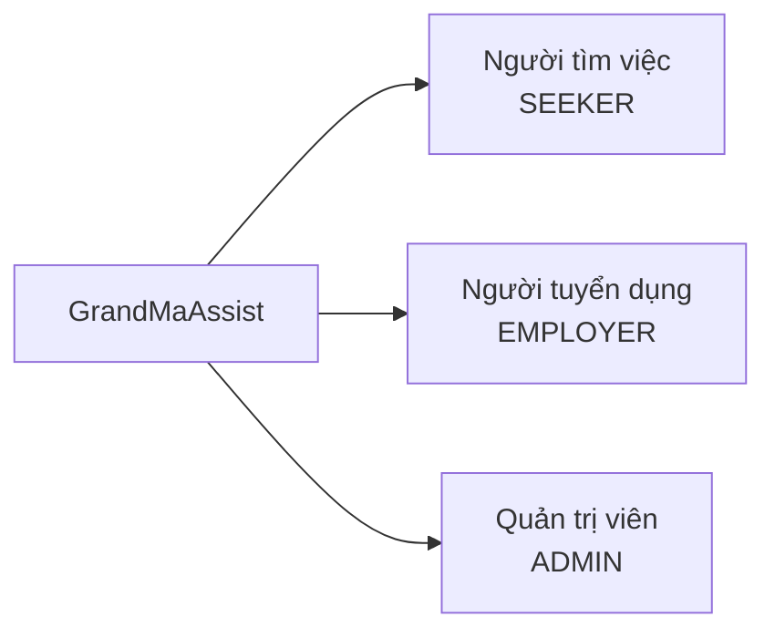
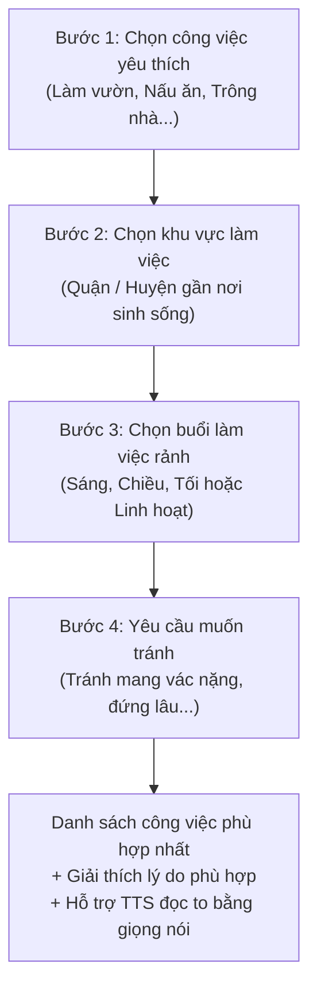
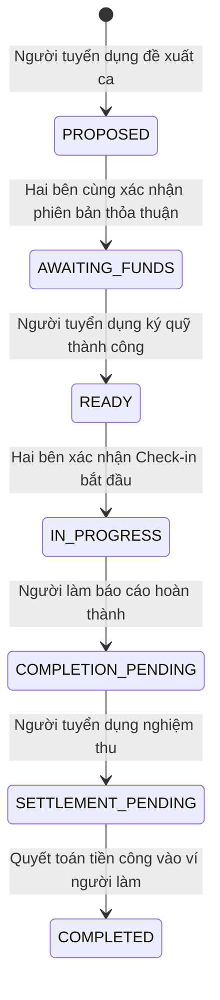

# GrandMaAssist 👵💼

> **Nền tảng hỗ trợ tìm kiếm việc làm bán thời gian phù hợp cho người cao tuổi & người nghỉ hưu**  
> *Đồ án môn Lập trình Thiết bị Di động — Nhóm 4 — Đại học Kinh tế TP.HCM (UEH)*

---

## 🌟 Giới thiệu tổng quan

**GrandMaAssist** là ứng dụng di động Android ra đời nhằm giải quyết rào cản tiếp cận công nghệ và thị trường lao động cho người cao tuổi, người đã nghỉ hưu. Ứng dụng kết nối những người lớn tuổi mong muốn tìm kiếm các công việc bán thời gian nhẹ nhàng, an toàn với các cá nhân, gia đình hoặc hộ kinh doanh nhỏ có nhu cầu tuyển dụng.

### Điểm nổi bật & Triết lý thiết kế thân thiện
- **Giao diện Trợ năng (Accessibility-First):** Cỡ chữ lớn, độ tương phản cao, nút bấm to bản, hạn chế tối đa thao tác nhập liệu phức tạp.
- **Trợ lý giọng đọc (Text-To-Speech - TTS):** Tích hợp công nghệ chuyển văn bản thành giọng nói, hỗ trợ đọc to các bước hướng dẫn và chi tiết tin tuyển dụng.
- **Quét mã CCCD tự động (ML Kit):** Trích xuất thông tin cơ bản từ mã QR trên Thẻ Căn cước công dân gắn chip, giúp tiết kiệm thời gian và hạn chế sai sót khi khai báo hồ sơ.
- **Minh bạch & An toàn:** Cơ chế duyệt hồ sơ nghỉ hưu, duyệt tin tuyển dụng trước khi công khai, thỏa thuận ca làm việc rõ ràng và mô hình ký quỹ an toàn (*Escrow Payment*).

---

## 👥 Các vai trò trong hệ thống

Hệ thống phân định rõ ràng quyền hạn và giao diện của 3 nhóm đối tượng:



1. **Người tìm việc (Job Seeker / Người lớn tuổi, Nghỉ hưu):**
   - Đăng nhập linh hoạt bằng Google hoặc Số điện thoại (xác thực OTP SMS thật).
   - Hoàn thiện hồ sơ cá nhân và gửi xác minh căn cước/hưu trí (được Admin phê duyệt trước khi ứng tuyển).
   - Tìm kiếm việc làm qua **Luồng hướng dẫn 4 bước** hoặc duyệt danh sách việc làm mở.
   - Ứng tuyển, thống nhất thỏa thuận ca làm việc, check-in khi bắt đầu, báo hoàn thành ca và nhận thanh toán vào ví.

2. **Người tuyển dụng (Employer / Cá nhân, Gia đình, Hộ kinh doanh):**
   - Soạn và lưu nháp tin tuyển dụng (hỗ trợ ngoại tuyến với SQLite).
   - Gửi duyệt tin tuyển dụng (địa chỉ cụ thể, thời gian, mức lương, yêu cầu thể lực).
   - Xem danh sách ứng viên, duyệt/từ chối đơn ứng tuyển.
   - Thỏa thuận ca làm (nhiệm vụ, thời gian, tiền công) và cấp tiền ký quỹ bảo đảm thanh toán.
   - Xác nhận hoàn thành ca làm và quyết toán chi trả tiền công cho người làm.

3. **Quản trị viên (Admin):**
   - Kiểm duyệt các tin tuyển dụng đang chờ (`PENDING_REVIEW` -> `OPEN` hoặc `REJECTED`).
   - Thẩm định hồ sơ xác minh căn cước công dân và bằng chứng hưu trí của người tìm việc.
   - Tiếp nhận báo cáo vi phạm, giải quyết tranh chấp ca làm việc và giám sát số dư ký quỹ vận hành.

---

## 🚀 Các luồng nghiệp vụ chính

### 1. Luồng Tìm việc có hướng dẫn 4 bước (4-Step Guided Search) ⭐
Đây là tính năng cốt lõi giúp người cao tuổi dễ dàng tìm được công việc phù hợp nhất với sức khỏe và quỹ thời gian mà không bị bối rối trước quá nhiều bộ lọc.



- **Bước 1 — Loại công việc:** Lựa chọn danh mục công việc nhẹ nhàng quen thuộc hoặc chọn *Chưa có ưu tiên*.
- **Bước 2 — Khu vực:** Giới hạn khu vực gần nhà để hạn chế việc di chuyển xa xôi.
- **Bước 3 — Thời gian:** Chọn các buổi làm việc phù hợp trong tuần hoặc chọn *Linh hoạt*.
- **Bước 4 — Tránh quá sức:** Chọn các tiêu chí thể lực muốn tránh (ví dụ: *Không mang vác nặng*, *Không đứng liên tục*, *Không đi lại nhiều*).
- **Kết quả đề xuất:** Hệ thống xếp hạng công việc theo độ phù hợp, hiển thị lý do đề xuất cụ thể (ví dụ: *"Đúng khu vực cô/chú đã chọn"*, *"Làm buổi sáng"*, *"Không yêu cầu mang vác nặng"*).

---

### 2. Luồng Đăng tin & Kiểm duyệt tuyển dụng
1. Người tuyển dụng soạn thảo nội dung tin tuyển dụng (có hỗ trợ lưu nháp vào SQLite).
2. Kiểm tra biểu mẫu (tiêu đề, địa chỉ làm việc cụ thể, ca làm, yêu cầu thể lực, tiền công).
3. Tin được gửi lên Firestore với trạng thái `PENDING_REVIEW`.
4. Admin thẩm định nội dung:
   - **Chấp thuận (`OPEN`):** Tin hiển thị công khai cho toàn bộ người tìm việc.
   - **Từ chối (`REJECTED`):** Kèm lý do để nhà tuyển dụng chỉnh sửa và gửi lại.

---

### 3. Luồng Thỏa thuận & Vòng đời Ca làm việc (Work Session Lifecycle)
Sau khi người tuyển dụng chấp thuận đơn ứng tuyển, hai bên tiến hành tạo và thực hiện ca làm việc:



- **Ký quỹ an toàn (Escrow):** Khi ca ở trạng thái `AWAITING_FUNDS`, người tuyển dụng nộp số tiền ký quỹ (gồm tiền công + 10% phí vận hành mô phỏng). Tiền được giữ an toàn trên hệ thống.
- **Quyết toán minh bạch:** Khi ca hoàn tất, tiền công được chuyển ngay lập tức vào số dư ví của người tìm việc, hiển thị lịch sử giao dịch rõ ràng `+xxx.xxx đ`. Đồng thời, tin tuyển dụng tương ứng tự động đóng nhận đơn.

---

## 🗄️ Kiến trúc Cơ sở dữ liệu

Ứng dụng kết hợp giữa **Cloud Firestore** (dữ liệu trực tuyến đồng bộ thời gian thực) và **SQLite** (bộ nhớ đệm ngoại tuyến).

### 1. Cloud Firestore Collections
| Collection Path | Mô tả nghiệp vụ |
|---|---|
| `users/{uid}` | Thông tin tài khoản, vai trò (`SEEKER`, `EMPLOYER`, `ADMIN`), số điện thoại đã xác minh, trạng thái duyệt. |
| `seekerProfiles/{uid}` | Hồ sơ chi tiết người tìm việc (kỹ năng, kinh nghiệm, thông tin đã duyệt). |
| `employerProfiles/{uid}` | Hồ sơ nhà tuyển dụng / gia đình / tổ chức. |
| `jobs/{jobId}` | Tin tuyển dụng (`PENDING_REVIEW`, `OPEN`, `REJECTED`, `CLOSED`, `HIDDEN`). |
| `applications/{applicationId}` | Đơn ứng tuyển (`PENDING`, `ACCEPTED`, `REJECTED`, `WITHDRAWN`) lưu snapshot điều khoản. |
| `workSessions/{sessionId}` | Thông tin ca làm việc, thỏa thuận ca (`AgreementSnapshot`), thời gian bắt đầu/kết thúc. |
| `wallets/{uid}` | Ví tài khoản cá nhân, lưu số dư khả dụng và subcollection `transactions` lịch sử biến động số dư. |
| `payments/{sessionId}` | Bản ghi ký quỹ và phân bổ quyết toán dòng tiền của từng ca. |
| `verificationRequests/{id}` | Yêu cầu xác thực CCCD & giấy tờ hưu trí gửi cho Admin duyệt. |
| `reports/{reportId}` | Báo cáo vi phạm tin tuyển dụng. |

### 2. SQLite Local Storage (Bộ nhớ đệm Offline)
- **`PublicJobStore` (`cached_jobs`):** Lưu trữ tạm thời danh sách tin tuyển dụng công khai đã xem, cho phép người lớn tuổi mở xem lại khi mất kết nối mạng.
- **`JobDraftStore` (`job_drafts`):** Lưu trữ nháp tin tuyển dụng theo từng `UID`, tránh mất dữ liệu khi mất kết nối hoặc thoát ứng dụng đột ngột.
- **`SavedJobStore` (`cached_saved_jobs`):** Lưu trữ danh mục các công việc mà người dùng đã đánh dấu yêu thích.

---

## 🛠️ Kỹ thuật & APIs sử dụng

- **Ngôn ngữ & Nền tảng:** Android Java (JDK 21), hỗ trợ `minSdk 29` (Android 10) đến `targetSdk 36` (Android 16).
- **Kiến trúc ứng dụng:** MVVM (Model-View-ViewModel) kết hợp Repository pattern, LiveData và Material Design 3 Components.
- **Firebase Authentication:**
  - Đăng nhập Google thông qua Credential Manager API.
  - Xác thực số điện thoại bằng OTP SMS thật qua Firebase Phone Auth.
  - Hỗ trợ liên kết tài khoản (*Account Linking*) Google và SĐT vào cùng một UID.
- **Cloud Firestore & Security Rules:**
  - Cơ chế Multi-Document Transactions đảm bảo tính toàn vẹn tài chính và trạng thái ca làm.
  - Bộ Firestore Security Rules chặt chẽ kiểm soát quyền đọc/ghi theo từng vai trò và trạng thái xác thực.
- **Google ML Kit Barcode Scanning:** Phân tích ảnh chụp thẻ CCCD để quét và trích xuất chuỗi thông tin định danh QR tự động.
- **Android Text-To-Speech (TTS):** Tích hợp phát giọng nói tiếng Việt hỗ trợ đọc màn hình, tùy chỉnh tốc độ đọc phù hợp với thính lực người cao tuổi.

---

## 💻 Hướng dẫn Cài đặt & Khởi chạy

### Yêu cầu môi trường
- **Android Studio:** Phiên bản Ladybug (2024.2+) hoặc mới hơn.
- **JDK:** Java Development Kit 21 (khuyến nghị dùng JetBrains Runtime `jbr-21` tích hợp sẵn trong Android Studio).
- **Thiết bị:** Máy ảo Android (Emulator) hoặc thiết bị thật chạy Android 10.0 (API 29) trở lên.

### Các bước thiết lập
1. **Clone repository:**
   ```bash
   git clone https://github.com/<your-repo>/GrandMaAssist.git
   cd GrandMaAssist
   ```

2. **Cấu hình Firebase:**
   - Đặt tệp `google-services.json` được cấp từ Firebase Console vào thư mục:
     ```text
     GrandMaAssist/app/google-services.json
     ```
   - Đảm bảo SHA-1 và SHA-256 của máy phát triển đã được cấu hình trong Firebase Console (để Google Sign-In và Phone Auth hoạt động).

3. **Mở và biên dịch dự án:**
   - Khởi động Android Studio, chọn **Open Project** và trỏ đến thư mục `GrandMaAssist`.
   - Chờ Gradle Sync hoàn tất các dependency.
   - Nhấn **Run (Shift + F10)** để cài đặt và chạy ứng dụng trên thiết bị.

---

## 👨‍💻 Thành viên nhóm phát triển

**Nhóm 4 — Đồ án Lập trình Thiết bị Di động (UEH):**

| STT | Họ và tên | Vai trò |
|:---:|---|---|
| 1 | **Phùng Cẩm Tân** | Trưởng nhóm / Full-stack Mobile Developer |
| 2 | **Nguyễn Duy Thành Tài** | Thành viên nhóm phát triển |
| 3 | **Dương Hoàng Sâm** | Thành viên nhóm phát triển |
| 4 | **Phạm Thiên Long** | Thành viên nhóm phát triển |

---
*GrandMaAssist — Kết nối việc làm, lan tỏa niềm vui tuổi già.* 🌿