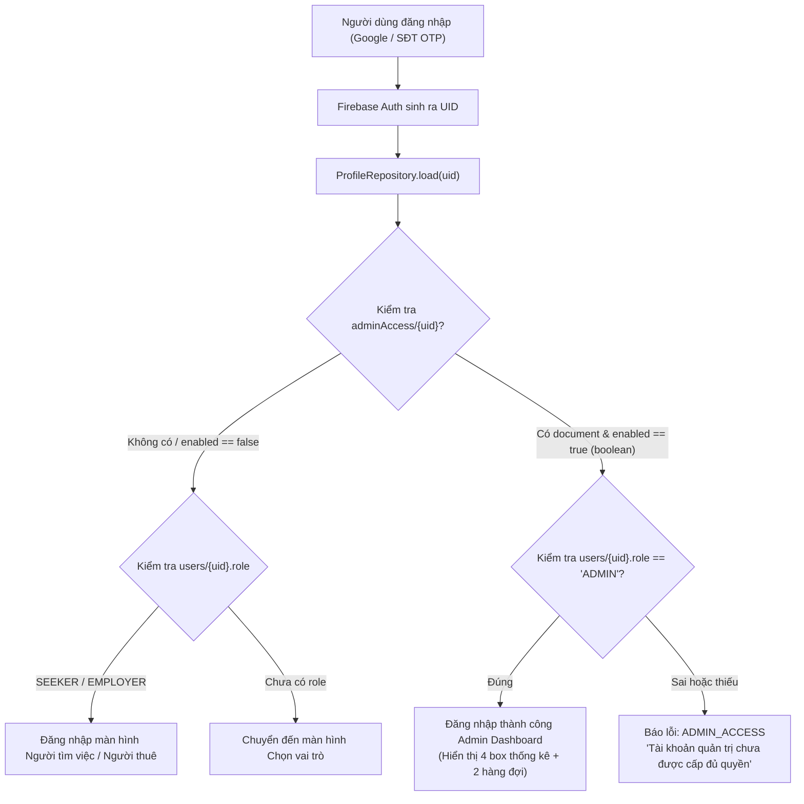

# HƯỚNG DẪN CHI TIẾT TẠO VÀ CẤP QUYỀN TÀI KHOẢN ADMIN TRÊN FIREBASE CONSOLE

> **Dự án:** GrandMaAssist — Ứng dụng hỗ trợ việc làm cho người cao tuổi  
> **Áp dụng cho:** Phiên bản hoàn thiện (v3) — Firebase Project: `grandmaassist-a1dfa` (hoặc project Firebase tương ứng của bạn)  
> **Tài liệu tham chiếu:** [`ProfileRepository.java`](file:///e:/Dev/Study'/Mobie/GrandMaAssist/GrandMaAssist/app/src/main/java/vn/edu/ueh/nhom4/grandmaassist/app/data/repository/ProfileRepository.java), [`firebase/firestore.rules`](file:///e:/Dev/Study'/Mobie/GrandMaAssist/GrandMaAssist/firebase/firestore.rules)

---

## 1. CƠ CHẾ BẢO MẬT VÀ PHÂN QUYỀN ADMIN TRONG GRANDMAASSIST

Để đảm bảo an toàn tuyệt đối, hệ thống GrandMaAssist sử dụng cơ chế **xác thực hai lớp (Two-Factor Grant & Role Verification)** kết hợp giữa Firebase Security Rules và Transaction trong ứng dụng:



### Yêu cầu bắt buộc để một tài khoản trở thành Admin:
1. **Document cấp quyền truy cập:** Nằm tại Collection `adminAccess`, Document ID bằng đúng `{UID}`, có trường `enabled = true` (kiểu dữ liệu **Boolean**).
2. **Document hồ sơ người dùng:** Nằm tại Collection `users`, Document ID bằng đúng `{UID}`, có trường `role = "ADMIN"` (kiểu dữ liệu **String** viết hoa) và `accountStatus = "ACTIVE"`.
3. Hai collection này nằm ở **cấp gốc (Root level)** của Cloud Firestore, ngang hàng với các collection `jobs`, `workSessions`, `categories`, `areas`.

---

## 2. QUY TRÌNH 4 BƯỚC CẤP TÀI KHOẢN ADMIN

### BƯỚC 1: Đăng nhập lần đầu trên ứng dụng để lấy mã `UID`

1. Chuẩn bị một tài khoản Google (hoặc số điện thoại) dự kiến dùng làm Quản trị viên.
   > **Lưu ý quan trọng:** Tài khoản này nên là tài khoản mới hoặc chưa từng chọn vai trò "Người tìm việc" hoặc "Người thuê" trong ứng dụng.
2. Mở ứng dụng **GrandMaAssist** trên điện thoại / máy ảo Android.
3. Chọn đăng nhập bằng Google hoặc nhập số điện thoại nhận mã OTP SMS.
4. Sau khi đăng nhập thành công, ứng dụng sẽ chuyển đến màn hình **"Chọn vai trò"** (Người tìm việc / Người thuê).
5. **DỪNG LẠI TẠI ĐÂY!** Không bấm chọn vai trò nào cả. Thoát ứng dụng hoặc đăng xuất tạm thời.
6. Truy cập vào **[Firebase Console](https://console.firebase.google.com/)** $\rightarrow$ Chọn Project của bạn.
7. Vào mục **Build** $\rightarrow$ **Authentication** $\rightarrow$ Tab **Users**.
8. Tìm đúng Email Google (hoặc Số điện thoại) bạn vừa dùng để đăng nhập.
9. Tại cột **User UID**, bấm vào biểu tượng sao chép để copy chuỗi UID (Ví dụ: `xK8jN2pL9mQ4rS1tV6wY0z...`).

---

### BƯỚC 2: Cấp quyền truy cập trong Collection `adminAccess`

1. Tại Firebase Console, vào mục **Build** $\rightarrow$ **Firestore Database** $\rightarrow$ Tab **Data**.
2. Kiểm tra xem đã có Collection mang tên `adminAccess` hay chưa:
   - **Nếu chưa có:** Bấm **Start collection** $\rightarrow$ Nhập Collection ID là `adminAccess` $\rightarrow$ Bấm Next.
   - **Nếu đã có:** Bấm chọn vào collection `adminAccess` $\rightarrow$ Bấm **Add document**.
3. Điền thông tin Document:
   - **Document ID:** Dán chính xác chuỗi `UID` đã copy ở Bước 1 (Tuyệt đối **KHÔNG** bấm Auto-ID, không dán email).
   - Thêm trường dữ liệu (Field):
     - **Field name:** `enabled`
     - **Type:** Chọn kiểu **boolean** (Không được chọn kiểu string)
     - **Value:** Chọn **true**
4. Bấm **Save** để lưu document.

---

### BƯỚC 3: Khởi tạo thông tin Admin trong Collection `users`

1. Cũng tại Firestore Database, chọn Collection `users` ở cột ngoài cùng (Cấp gốc).
2. Bấm **Add document**:
   - **Document ID:** Dán chính xác chuỗi `UID` ở Bước 1 vào ô này.
3. Nhập các trường thông tin theo bảng chuẩn sau:

| Field Name | Type | Value | Ghi chú |
|---|---|---|---|
| `id` | **string** | *(Dán chuỗi UID Admin)* | Phải khớp 100% với Document ID |
| `role` | **string** | `ADMIN` | Bắt buộc viết HOA toàn bộ |
| `accountStatus` | **string** | `ACTIVE` | Bắt buộc viết HOA toàn bộ |
| `displayName` | **string** | `Quản trị viên hệ thống` | Hoặc tên hiển thị bạn muốn |
| `createdAt` | **timestamp** | *(Bấm chọn ngày giờ hiện tại)* | Thời điểm tạo |
| `updatedAt` | **timestamp** | *(Bấm chọn ngày giờ hiện tại)* | Thời điểm cập nhật |

> [!IMPORTANT]
> **Quy tắc kiểu dữ liệu:**
> - `enabled` trong `adminAccess` **bắt buộc là Boolean `true`**.
> - `role` trong `users` **bắt buộc là String `"ADMIN"`**.
> - Cả hai document ID phải cùng mang một giá trị `UID` duy nhất lấy từ Authentication.

4. Bấm **Save** để hoàn tất.

---

### BƯỚC 4: Đăng nhập và trải nghiệm giao diện Admin Dashboard

1. Mở lại ứng dụng **GrandMaAssist** trên thiết bị di động.
2. Đăng nhập bằng đúng tài khoản Google hoặc SĐT đã cấp quyền ở trên.
3. Hệ thống sẽ tự động phát hiện quyền Admin và điều hướng trực tiếp vào **Trang chủ Quản trị viên (Admin Home)**:
   - **Thanh điều hướng trên cùng (Topbar):** Hiển thị nhãn **Quản trị viên** cùng nút làm mới (Reload) dữ liệu ở góc phải.
   - **Dashboard 4 khối thống kê thời gian thực (2 hàng 2 cột):**
     1. **Người thuê:** Số lượng người thuê (Đã xác minh / Tổng cộng). Bấm vào chuyển đến danh sách hồ sơ người thuê.
     2. **Người tìm việc:** Số lượng người cao tuổi (Đã duyệt hưu trí / Tổng cộng). Bấm vào chuyển đến danh sách thẩm định hưu trí.
     3. **Tin tuyển dụng:** Số lượng tin (Đang mở / Tổng tin đăng). Bấm vào chuyển đến trang duyệt tin.
     4. **Doanh thu phí sàn:** Tổng số tiền phí dịch vụ 10% thu được từ các ca làm đã hoàn tất thành công (Hiển thị đơn vị VNĐ). Bấm vào xem chi tiết báo cáo thống kê.
   - **Hàng đợi cần xử lý (Queues):**
     - **Tin cần duyệt:** Hiển thị số lượng tin đang ở trạng thái `PENDING_REVIEW` (Ví dụ: *"Hiện có 3 tin đang chờ duyệt"*). Bấm vào để duyệt ngay.
     - **Hồ sơ chờ duyệt:** Hiển thị số lượng hồ sơ CCCD/hưu trí đang ở trạng thái `SUBMITTED` (Ví dụ: *"Hiện có 2 hồ sơ chờ duyệt"*). Bấm vào để thẩm định hồ sơ.

---

## 3. HƯỚNG DẪN XỬ LÝ SỰ CỐ THƯỜNG GẶP (TROUBLESHOOTING)

### Sự cố 1: Báo lỗi "Tài khoản quản trị chưa được cấp đủ quyền" (Lỗi `ADMIN_ACCESS`)
* **Nguyên nhân:**
  1. Trường `enabled` trong `adminAccess/{uid}` bị chọn nhầm kiểu dữ liệu thành **string** (`"true"`) thay vì **boolean** (`true`).
  2. Document `adminAccess/{uid}` đã có nhưng document `users/{uid}` chưa được tạo hoặc trường `role` không phải là chữ `"ADMIN"` in hoa.
  3. Chuỗi UID giữa hai collection không khớp nhau (thừa khoảng trắng hoặc gõ nhầm).
* **Cách khắc phục:**
  - Vào Firestore Console, kiểm tra kỹ kiểu dữ liệu của `enabled` là `boolean`.
  - Kiểm tra `role` trong `users/{uid}` là `string` với giá trị `ADMIN`.

### Sự cố 2: Đăng nhập vào vẫn hiện màn hình "Chọn vai trò" (Người tìm việc / Người thuê)
* **Nguyên nhân:**
  - Ứng dụng không tìm thấy document `adminAccess/{uid}` tương ứng với tài khoản đang đăng nhập. Có thể bạn đã dán nhầm email vào Document ID thay vì dán chuỗi UID.
* **Cách khắc phục:**
  - Vào Authentication $\rightarrow$ Users $\rightarrow$ Copy lại đúng chuỗi UID của tài khoản đó.
  - Sửa lại Document ID của cả 2 collection `adminAccess` và `users` thành chuỗi UID này.

### Sự cố 3: Tạo nhầm `users` thành Subcollection nằm bên trong `adminAccess`
* **Nguyên nhân:**
  - Trong Firestore, bạn bấm "Start collection" bên trong document của `adminAccess`.
* **Cách khắc phục:**
  - Xóa subcollection đó đi. Ra ngoài màn hình Root (cấp cao nhất của database, ngang hàng với `adminAccess`, `jobs`, `areas`) và tạo collection `users`.

### Sự cố 4: Tài khoản đã lỡ bấm chọn vai trò "Người tìm việc" hoặc "Người thuê" trước đó
* **Nguyên nhân:**
  - Tài khoản này đã có sẵn các document nghiệp vụ như `jobSeekerProfiles` hoặc `employerProfiles` và `role` đang là `SEEKER` hoặc `EMPLOYER`.
* **Cách khắc phục:**
  - **Cách tốt nhất:** Dùng một tài khoản Google hoặc SĐT khác chưa từng đăng nhập vào app để cấp quyền Admin sạch.
  - **Nếu bắt buộc dùng tài khoản này:** Vào Firestore Console $\rightarrow$ Tìm document `users/{uid}` $\rightarrow$ Đổi trường `role` thành `ADMIN` $\rightarrow$ Xóa trường `retirementStatus` hoặc `identityStatus` trong document `users` đó (nếu có). Sau đó tạo document `adminAccess/{uid}` với `enabled: true`.

---

## 4. TỔNG KẾT BẢNG THAM CHIẾU CẤU HÌNH FIRESTORE ADMIN

```text
Firestore Root
│
├── adminAccess/
│   └── [UID_CỦA_ADMIN]  <-- Document ID là UID
│       └── enabled: true (boolean)
│
└── users/
    └── [UID_CỦA_ADMIN]  <-- Document ID là UID
        ├── id: "[UID_CỦA_ADMIN]" (string)
        ├── role: "ADMIN" (string)
        ├── accountStatus: "ACTIVE" (string)
        ├── displayName: "Quản trị viên" (string)
        ├── createdAt: [Timestamp]
        └── updatedAt: [Timestamp]
```
*(Chỉ cần 2 document này, Quản trị viên đã có thể vận hành trọn vẹn mọi tính năng giám sát, thẩm định và thống kê của hệ thống GrandMaAssist).*
